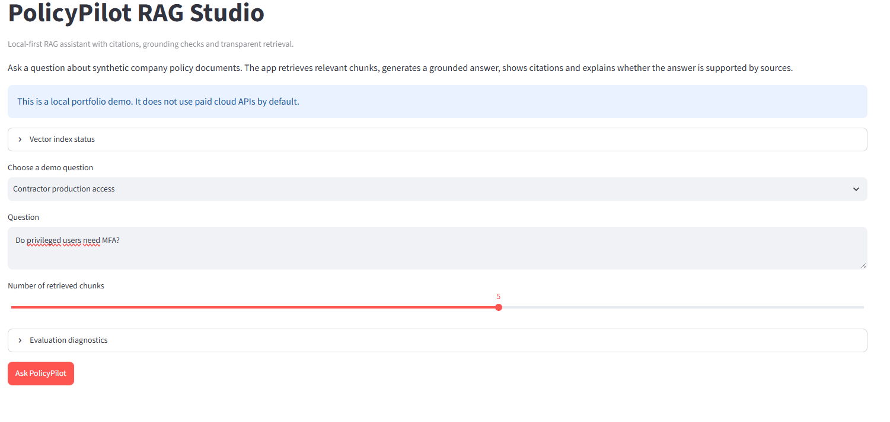
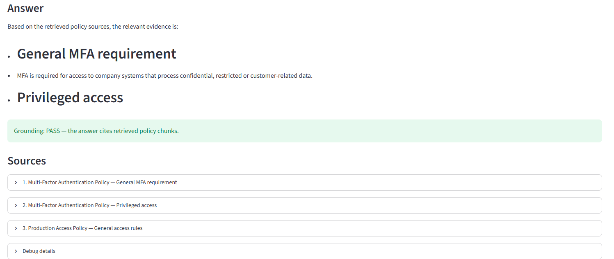
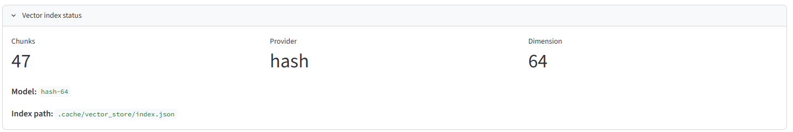
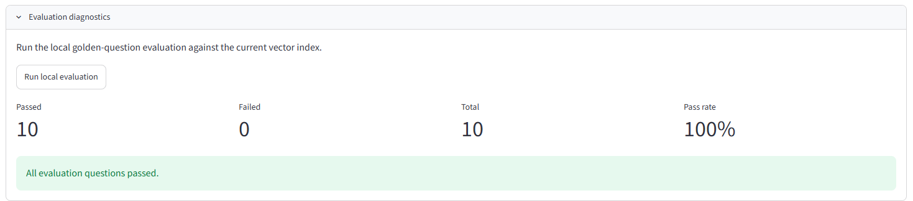
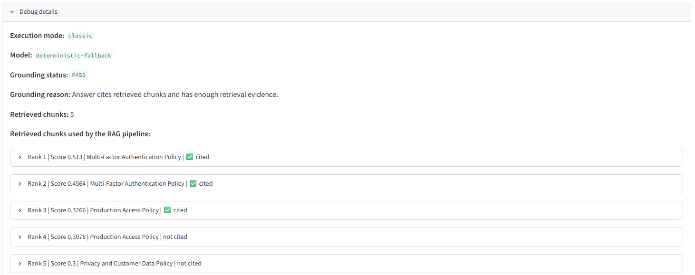

# PolicyPilot RAG Studio

A transparent, local (for now) RAG engineering lab built around synthetic policy and security documents.

PolicyPilot RAG Studio demonstrates how a Retrieval-Augmented Generation system can ingest documents, build a local vector index, retrieve grounded evidence, answer with citations, refuse unsupported questions, and evaluate itself against golden questions.


## What am I showing with this project

- Markdown document ingestion with metadata
- Heading-aware chunking
- Local embeddings with a deterministic hash fallback
- Local vector index generation
- Vector retrieval with ranked chunks
- Grounded answers with source citations
- Refusal behavior when the documents do not support an answer
- RAG debugger in Streamlit
- Vector index status panel
- Evaluation diagnostics panel
- Golden-question evaluation
- RAG quality gate for CI
- Classic RAG execution mode
- LangGraph execution mode
- MCP-ready tools
- pytest test suite
- GitHub Actions workflow
- Basic Docker setup for local demo usage

## Why this project exists

I built PolicyPilot RAG Studio to practice an end-to-end RAG workflow in a way that is transparent and testable.

The goal is not to hide the retrieval process behind a chatbot interface. The goal is to make the RAG pipeline visible:

1. Which documents were loaded?
2. How were they chunked?
3. Which chunks were retrieved?
4. Which chunks were cited?
5. Did the answer stay grounded?
6. Did the system refuse when it had no evidence?
7. Can the behavior be tested automatically?

## Local-first and zero-cost by default

The project runs locally by default.
Cloud extensions may be documented later as optional architecture notes, but the default implementation is intentionally local and cost-safe.

## Demo experience

The Streamlit app lets:

- choose a demo policy question
- ask a custom policy question
- switch between Classic RAG and LangGraph RAG execution
- inspect the generated answer
- review cited sources
- open debug details
- inspect retrieved chunks
- run local evaluation diagnostics
- check vector index status

Example supported questions:

- Can contractors access production systems?
- Do privileged users need MFA?
- What should employees do after a security incident?
- Is VPN required when using airport Wi-Fi?
- Can employees paste API keys into public AI tools?

Example questions the system should refuse:

- What is the CEO's favorite restaurant?
- What is the employee salary increase plan for next year?
- Which secret project will be launched next quarter?


## Application screenshots

### PolicyPilot interface



### Grounded answers with citations



### Local vector index diagnostics



### Evaluation dashboard



### Retrieval and grounding debugger




## Quick start

Clone the repository:

```bash
git clone https://github.com/ffbogusia/policypilot-rag-studio.git
cd policypilot-rag-studio
```

Create and activate a virtual environment:

```bash
python -m venv .venv
source .venv/bin/activate
```

On Windows PowerShell:

```powershell
python -m venv .venv
.venv\Scripts\Activate.ps1
```

Install dependencies:

```bash
python -m pip install --upgrade pip
python -m pip install -r requirements.txt
```

Run the test suite:

```bash
make test
```

Build the local vector index:

```bash
make index
```

Run the RAG quality gate:

```bash
make quality-gate
```

Start the Streamlit app:

```bash
make app
```

## Useful commands

```bash
make test           # Run pytest
make index          # Build the local vector index
make eval           # Run local RAG evaluation and write a Markdown report
make quality-gate   # Run evaluation with a minimum pass-rate threshold
make app            # Build the index and start Streamlit
make mcp-smoke      # Run the MCP smoke check
make docker-config  # Validate docker-compose.yml
make clean          # Remove generated local caches
```

## Repository structure

```text
policypilot-rag-studio/
  app/                    Streamlit UI and app-level helpers
  agent/                  LangGraph workflow state and nodes
  config/                 Configuration area
  data/sample_policies/   Synthetic policy documents
  docs/                   Architecture and integration notes
  eval/                   Golden questions and evaluation runner
  ingestion/              Document loading, chunking, embeddings, index build
  mcp_server/             MCP-ready tool wrappers and server entrypoint
  rag/                    Prompting, grounding, citations, answer generation
  retrieval/              Local vector retrieval
  tests/                  pytest test suite
  .github/workflows/      CI workflow
```

## Architecture overview

```text
Synthetic Markdown policies
        ↓
Document loader
        ↓
Chunking with metadata
        ↓
Local embedding provider
        ↓
Local vector index
        ↓
Retriever
        ↓
Grounded answer generator
        ↓
Citations + refusal behavior
        ↓
Streamlit RAG Studio
        ↓
Evaluation + quality gate
```

The app supports two execution paths:

```text
Classic RAG:
question → retrieve chunks → generate grounded answer → return citations/debug data

LangGraph RAG:
question → retrieval node → evidence check node → answer generation node → workflow debug data
```

## Evaluation

PolicyPilot includes a golden-question evaluation set.

The evaluation checks whether:

- the expected source document was retrieved
- refusal behavior matched expectations
- required answer content appeared
- the final answer passed grounding checks

The quality gate can be run locally:

```bash
make quality-gate
```

This is also suitable for CI because it turns RAG behavior into a measurable test instead of a purely manual demo.

## MCP integration

The project includes MCP-ready tools for:

- answering a policy question
- searching policy documents
- retrieving a chunk by ID
- running local RAG evaluation

See:

- [MCP integration](docs/mcp.md)

## Documentation

- [Architecture overview](docs/architecture.md)
- [MCP integration](docs/mcp.md)

## Responsible AI and safety notes

All sample documents are synthetic and created for educational purposes.

This repository does not contain:

- real company data
- real employee data
- real customer data
- real credentials
- real secrets
- confidential procedures

The project is not legal, HR, compliance, or security advice. It is a technical portfolio demo showing how a local RAG system can be built, tested, inspected, and improved.

## DevOps notes

The project includes:

- pytest-based automated tests
- a RAG evaluation quality gate
- GitHub Actions CI
- Docker configuration for local demo usage
- ignored local caches and generated vector index files

Generated local artifacts such as `.cache/`, `.venv/`, and `.env` should not be committed.

## Roadmap

Completed core areas:

- document ingestion
- chunking
- local embeddings
- local vector index
- retrieval
- grounded answers
- citations
- refusal behavior
- Streamlit UI
- RAG debugger
- evaluation diagnostics
- vector index status
- golden-question evaluation
- quality gate
- LangGraph workflow
- MCP-ready tools
- CI basics
- Docker basics

Possible future improvements:

- add screenshots to the README
- polish Docker healthcheck and non-root container user
- add Docker image build check in CI
- add optional Kubernetes manifests in a separate DevOps-focused project
- document optional Azure architecture without making cloud usage required